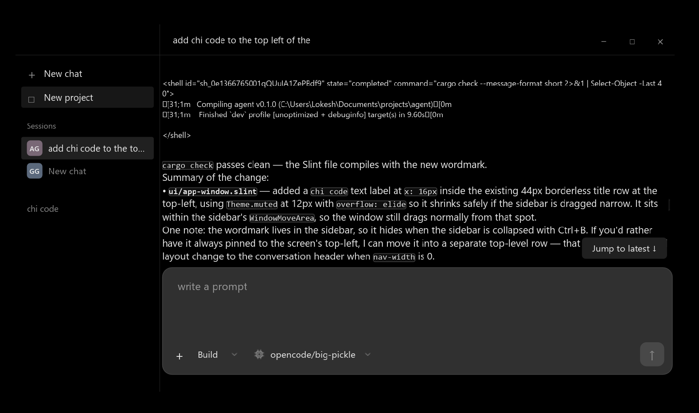

# chi code

> computers are fast.

a native desktop GUI for sending and receiving messages from coding agent harnesses.

| App | Memory Usage | Diff |
|---|---:|---:|
| **Chi Code** | **40 - 90 MB** | **100%** |
| OpenCode Desktop | 400 - 700 MB | 444% - 1750% |
| CC Desktop | 400 MB - 1.5 GB | 444% - 3750% |
| T3 Code | 400 MB - 1.5 GB | 556% - 3750% |
| ChatGPT Desktop | 750 MB - 1.5 GB | 833% - 3750% |





## features
- connect to opencode agent

## getting started

```bash
cargo run
```
